# Contributing to RenkuOS

Status: **draft for comment.** Feedback is welcome! Please post on the forums with questions, comments, suggestions, or any other feedback.

This document covers how to get the source, build it, and submit a change. What happens to
your change *after* you open it — who reviews it, what they may and may not block on, and how
disagreements get settled — is in [`REVIEW.md`](REVIEW.md). Read that one too; it is short and
it is the part most projects leave you to guess at.

The decisions this document depends on are recorded in [`DECISIONS.md`](DECISIONS.md).

---

## Current state

**Where the code is.** [`RenkuOS/Source`](https://github.com/RenkuOS/Source), branch `main`.

**How a change lands.** You cannot push to `main` — every change goes through a pull request,
and that applies to admins too. One approval merges it. Your own approval never counts
toward your own change, and an approval is dropped if you push again afterwards.

**Who can approve.** Four people hold write access today. An approval from anyone else —
including organisation members with read access — is worth having but does not satisfy the
gate. Nobody is assigned to your change automatically: `MAINTAINERS` and `CODEOWNERS` do not
exist yet, so if you need a particular pair of eyes, say so in the pull request.

**What CI checks.** `policy checks`, `build x86_64` and `boot x86_64` must all pass before a
merge is possible. Note the architecture: **x86 is not currently built or booted**. Tier 1
still means both 32- and 64-bit as policy (D4), but the 32-bit gate is suspended — see
[`REVIEW.md`](REVIEW.md) Current state for why.

**What will block your pull request:**

- A commit without `Signed-off-by:` — use `git commit -s`
- A new file without an SPDX identifier
- More than 1,000 changed lines, unless someone applies the `oversize-approved` label
- Touching more than two subsystems
- `clang-format` differences on lines you changed
- `Ported-from:` without `Ported-from-license:`, or the reverse

**What will only warn you:** a subject line of 72 characters or more, and a subject with no
`subsystem: ` prefix. Both are still worth getting right.

---

## You do not have to write C++ to be useful

Roughly half the work this project needs is not kernel code, and none of it is a lesser
contribution:

- **Testing on real hardware.** Boot a nightly, tell us what broke. Include the machine, the
  chipset, and the syslog. This is genuinely the most valuable thing an unfamiliar
  contributor can do, because we cannot buy every machine.
- **Bug triage.** Turning a forum post or a vague report into a reproducible ticket.
- **Documentation.** API docs, guides, release notes.
- **Translation.**
- **Ports and packaging.**
- **Artwork and design.**

If you report a problem and someone tells you to "just file a ticket", that is a bug in
*us*, not in you. A rotating volunteer converts reports from the forum into tickets, so you
are never required to learn a second tool to be heard. Ask in the forum if you would rather
not deal with the tracker at all.

---

## Getting the source

The current source is hosted on GitHub: [https://github.com/RenkuOS/Source](https://github.com/RenkuOS/Source). Please clone into your own repo, and make your own Feature branch. Do not attempt to merge directly into Main.

---

## Building

---


## Making a change

### Keep it one change

One logical change per pull request. 

A change spanning more than two subsystems is over the size cap regardless of line count — split it and land the enabling parts first. 

The full caps
are in [`REVIEW.md`](REVIEW.md) §2; the short version is that 400 lines is routine, 1,000
needs a splitting plan agreed with the area maintainer.

### Match the surrounding code

We inherit Haiku's coding style and keep it, at least through the first year. This is not
deference — the tree is written in it, a reformat destroys `git blame` exactly when our
upstream cherry-picks depend on it, and every reformatted hunk becomes a permanent conflict.

Do not open a pull request that reformats code you are not otherwise changing.

### Licensing your new file

Every file you add needs an SPDX identifier. New code written for RenkuOS is MIT, so a new
C or C++ file starts:

    /*
     * Copyright 2026, The RenkuOS authors.
     * Distributed under the terms of the MIT License.
     *
     * SPDX-License-Identifier: MIT
     */

For a shell script, a Jamfile, or anything else taking `#` comments, one line is enough:

    # SPDX-License-Identifier: MIT

A file you ported is different. It keeps the upstream identifier — `BSD-3-Clause`,
`GPL-2.0+`, or whatever the original carries — and the commit needs the `Ported-from:` and
`Ported-from-license:` trailers with it. See [`REVIEW.md`](REVIEW.md) §1.3.

Files inherited from Haiku are grandfathered. Do not add headers to files you did not
create, and do not relicense what we inherited. The rule is D3 in
[`DECISIONS.md`](DECISIONS.md), and `lint` only checks files your change adds.

### Commit messages

    subsystem: short imperative summary, under 72 characters

    Body wrapped at 72 columns. Say what changed and why. If there is
    something you are unsure about, say that here — it is the most useful
    sentence in the whole message.

    Signed-off-by: Your Name <you@example.org>

Signatures, in order, as they apply:

| Trailer | When | Example |
|---|---|---|
| `Signed-off-by:` | **Always** | `Signed-off-by: Jane Doe <jane@example.org>` |
| `Assisted-by:` | A tool wrote a substantial part | `Assisted-by: claude-opus-5` |
| `Ported-from:` | Code came from another project | `Ported-from: freebsd 14.1 sys/dev/e1000/if_em.c` |
| `Ported-from-license:` | With `Ported-from:` | `Ported-from-license: BSD-2-Clause` |

`Signed-off-by:` is a Developer Certificate of Origin sign-off, not a copyright assignment.
`git commit -s` adds it for you. It states you had the right to submit what you submitted.

---

## Tooling, briefly

Machine-assisted contributions are welcome here. That is a deliberate choice and it comes
with exactly three obligations:

1. **Disclose it** with an `Assisted-by:` trailer where a tool wrote a substantial part —
   more than roughly twenty lines you kept, or the design of the change itself. Autocomplete
   and formatters do not count.
2. **Own it.** You are the engineer of record for every line. 
3. **Check where the code came from.** The real risk is a tool reproducing copyleft or
   proprietary code with nobody noticing. If code came from another project, say so in the
   signatures.

Avoid long AI generated prose. PR notes, commit messages, and comments should be detailed but concise.

---

## Opening the pull request

Before you open it:

- [ ] You have tested the change, either on hardware or in a VM
- [ ] `Signed-off-by:` on every commit, plus any other signatures that apply.
- [ ] Within the size cap, or a splitting plan agreed with the maintainer.
- [ ] A summary of the change.
- [ ] A **How this was tested** section (See next section).

Open it ready for review once the checklist is done. 

Use a draft only for work you do not want reviewed yet, and say in the description what is missing.

### The "How this was tested" section is not optional

"Builds fine" is not a verification statement. What is expected scales with what your change
can break — the full table is [`REVIEW.md`](REVIEW.md) §3, and briefly:

| If you changed… | Say… |
|---|---|
| Docs, translations | that CI is green |
| An app or preflet | that the smoke pass passes |
| A driver | the hardware you tested on, with model and PCI or USB ID |
| A filesystem write path, kernel, VM, scheduler, boot loader, package solver, crypto | real hardware, the stress run you did, and how to revert |

For a bugfix, the standard is a test that would have caught the bug.


---

## Reporting a bug

Include, or the ticket will bounce back to you for it:

- The build you are running — the revision, not "the latest".
- Architecture and how you installed it.
- Hardware: machine model, CPU, and the relevant chipset or device ID.
- What you did, what happened, what you expected.
- `/var/log/syslog`, attached rather than pasted, and a serial log if you have one.

If it does not reproduce on a current nightly, say so — that is useful information, not a
reason to stay quiet.


---

## Contributing a driver

Drivers are the high value contributions. Please name the hardware that it was tested on: model, and the PCI/USB ID. 

If there are multiple devices supported by the driver, try to list them in your PR and indicate which ones you have been able to test. Perhaps other users/developers can test other devices in the driver family.

---

## Getting credited

Contributors can be listed in the RenkuOS About window. This is opt-in. To be listed, add a
row with your GitHub handle and the name you want shown to
[`contributors.md`](https://github.com/RenkuOS/Source/blob/main/contributors.md) in
RenkuOS/Source:

```
|your-github-handle|Your Display Name|
```

Make the change in a pull request, either in your first contribution or on its own. The usual
`Signed-off-by:` rule applies. To change or remove your entry later, open another pull request.

---

## Where to ask

- The forum, for anything.
- The pull request itself, for questions about a specific change.
- `MAINTAINERS`, to find out who owns the code you are touching.

Asking a question is never an imposition. If someone makes you feel it was, that is worth
raising — see `CODE_OF_CONDUCT.md`.
