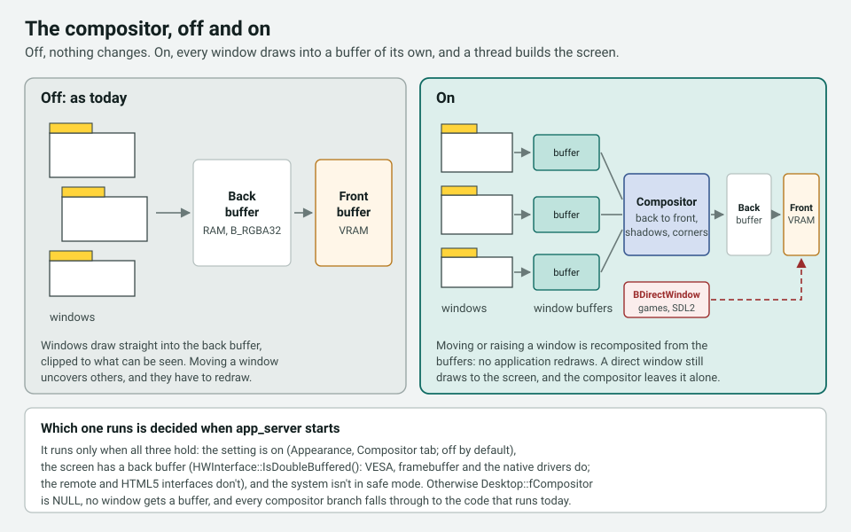
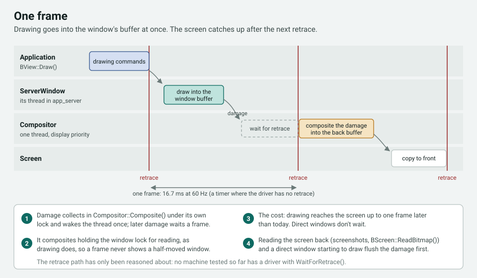
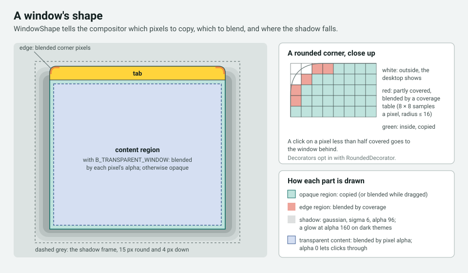
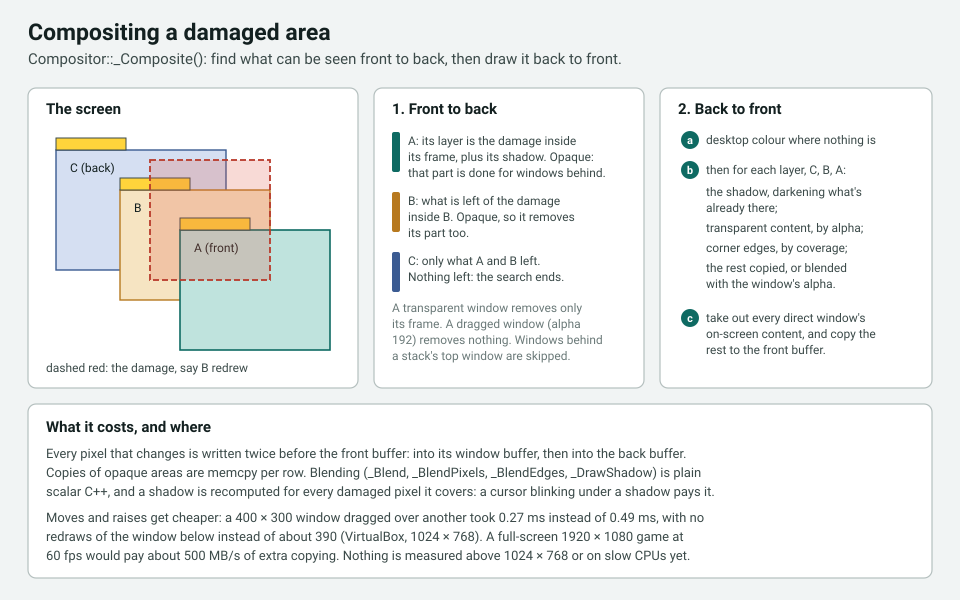
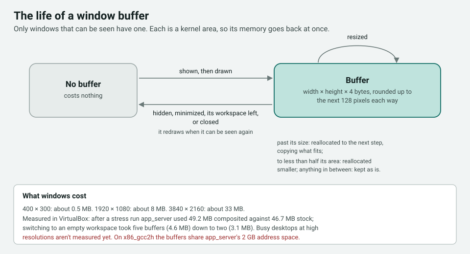

# The composited app_server: design

Status: **under review**, 2026-11-13. Owner: Ian Dumych. Proposal and discussion:
RenkuOS/Source#378. The code is the PR series #330–#341 and #377.

Code references are against that series. Paths without a directory are in `src/servers/app/`.

---

## Summary

With the compositor on, every window draws into a buffer of its own, and one thread builds the
screen from those buffers. That gives windows rounded corners, soft shadows, and see-through
dragging. Moving or raising a window costs no redraws, and an application can have a
transparent window.

**It is off by default.** With it off, `app_server` draws exactly as it does today. It's turned
on in Appearance's Compositor tab and takes effect when `app_server` next starts. Safe mode
never runs it.

This document explains how it works, for anyone who has to review, debug, or change it. It
doesn't argue for it; that's in #378.

---

## 1. Off means off

`Desktop::Init()` creates the compositor only when all three of these hold:

- the setting is on (`DesktopSettings::CompositedDesktop()`, off by default);
- the screen has a back buffer (`HWInterface::IsDoubleBuffered()`). `AccelerantHWInterface`
  always makes one, so VESA, framebuffer and the native drivers qualify. The remote and HTML5
  interfaces don't, and stay uncomposited;
- the system isn't in safe mode (`Desktop::_IsSafeMode()`).

Otherwise `Desktop::fCompositor` is NULL and no window gets a `WindowBuffer`. Every new branch
in `Window`, `Desktop`, `View` and `ServerWindow` tests one of those two pointers first, with
today's code unchanged in the `else`. `Window::ShapeContains()` returns `true` at once.

The one change that applies with it off is #330, the gradient fix (§13).

---

## 2. The pieces

| Class | File | What it does |
|---|---|---|
| `WindowBuffer` | `WindowBuffer.cpp` | A `B_RGBA32` buffer in a kernel area of its own. Its bits pointer is offset so that it takes screen coordinates, so `Painter`, `DrawingEngine` and the views draw into it unchanged. |
| `WindowBufferHWInterface` | `WindowBuffer.cpp` | An `HWInterface` over one `WindowBuffer`. Each composited window gets its own `DrawingEngine` on one of these, instead of sharing the screen's. Drawing reports damage to the compositor. |
| `Compositor` | `Compositor.cpp` | Builds the screen's back buffer from the window buffers, back to front, on its own thread, and copies what changed to the front buffer. |
| `WindowShape` | `WindowShape.cpp` | A window's outline: its opaque region, the edge pixels of rounded corners with their coverage, and its shadow. |
| `RoundedDecorator` | `decorator/RoundedDecorator.cpp` | An opt-in mixin a decorator inherits to get rounded corners and draw its border along the curve. Default and Flat use it. |

`Window` gains the compositor's members at the end of the class (§10). `Desktop` gains
`fCompositor` and a few calls into it: when windows move, are raised, shown or hidden, and when
the workspace or the screen mode changes (`Compositor::SceneChanged()`).

---

## 3. A frame

1. An application's drawing commands reach its `ServerWindow` thread, which draws them into
   the window's buffer, as today but into the buffer. The changed area goes to
   `Compositor::Composite()`, which adds it to the pending damage under `fDamageLock` and
   wakes the compositor thread, once per frame.
2. The compositor thread (`B_DISPLAY_PRIORITY`) waits in `_WaitForFrame()`: for the vertical
   retrace where the driver has `WaitForRetrace()`, otherwise until 16.7 ms after the last
   frame. It logs which one it uses at startup ("compositor paced by …").
3. It takes the damage and composites it with the window lock held for reading. That's the
   same lock drawing commands take, so a frame never shows a window half moved.
4. `HWInterface::InvalidateRegion()` copies the damaged area from the back buffer to the front
   buffer, as today.

**Latency.** Drawing reaches the screen up to one frame (about 16.7 ms) later than today.
Direct windows are exempt (§8).

**Flushes.** Two things need the screen up to date at once, and call `Flush()` or
`FlushLocked()`: reading the screen back (screenshots, `BScreen::ReadBitmap()`), and a direct
window about to draw.

---

## 4. Window shapes

`Window::SetClipping()` builds the window's `WindowShape` from its decorator's outline:

- **Outline.** `Decorator::GetShape()` returns the frame as rectangles, non-virtual so the
  vtable doesn't change. A `RoundedDecorator` returns the same rectangles with corner radii.
- **Edges.** For each radius up to 16 px, a coverage table, sampled 8 × 8 per pixel, says how
  much of each corner pixel the outline covers. Those pixels are blended; fully covered ones
  are copied.
- **Shadow.** A gaussian blur of the outline with sigma 6, from a precomputed `erf` profile,
  15 px round and 4 px down, at alpha 96. On a dark theme (the panel background is dark) it's
  a glow at alpha 160, with no offset. No-border windows, the desktop, and `BWindowScreen`
  windows have none.
- **Clicks.** `Window::ShapeContains()`: a click on a corner pixel less than half covered, or
  on a pixel of a transparent window whose alpha is 0, goes to the window behind.

---

## 5. Compositing

`Compositor::_Composite(damage)` works in two passes.

**Front to back,** it finds what can be seen. For each window on the current workspace, from
the front, it makes a layer: the damage still uncovered within the window's composite region,
and the part of its shadow frame outside its opaque region. A window drawn at full alpha then
takes its opaque region out of the remaining damage. When nothing remains, the search stops.
A transparent window takes out only its frame, and a window being dragged (alpha 192) takes
out nothing. A stack draws only its top window, since the others have the same outline.

**Back to front,** it draws. What no layer covers gets the desktop colour. Then each layer, from
the back:
1. the shadow darkens what's already there;
2. a transparent window's content is blended by each pixel's alpha;
3. corner edges are blended by coverage;
4. the rest is copied a row at a time with `memcpy`, or blended with the window's alpha while
   it's dragged.

Last, every direct window's on-screen content is taken out of the area, and the rest is copied
to the front buffer (§8).

---

## 6. Window buffers and memory

- A buffer is a kernel area, so freeing it returns the memory at once, and `listarea` on
  `app_server` shows each one as "window buffer".
- It is sized to the window's full frame, decorator included, rounded up to the next 128 px each
  way, so that most steps of a resize don't reallocate. It grows when the window outgrows it,
  copying what fits. When the window falls below half the buffer's area, it's reallocated
  smaller.
- It's freed when the window is hidden or minimized, or when its workspace is left. The window
  redraws in full when it can be seen again.
- A visible window costs width × height × 4 bytes: about 0.5 MB for 400 × 300, 8 MB for
  1920 × 1080, and 33 MB for 3840 × 2160.

On x86_gcc2h, the buffers share `app_server`'s 2 GB of address space with everything else it
has. A busy desktop at a high resolution could run it out. The compositor stays off by default
there, as everywhere.

---

## 7. Settings

| Setting | Default | Takes effect |
|---|---|---|
| Composited desktop | off | when `app_server` starts |
| Shadows (a glow on dark themes) | on | at once |
| Rounded corners | on | at once |
| See-through windows while dragging | off | at once |

They're stored with the other desktop settings. Appearance's Compositor tab sets them through
`AS_SET_COMPOSITED_*`, and greys out the options while the compositor isn't running.

---

## 8. Special cases

**`BDirectWindow`.** A direct window draws straight into the front buffer, so its window buffer
is stale. `ServerWindow::HandleDirectConnection()` flushes pending damage before the
application starts drawing, and gives it `Window::GetOnScreenContentRegion()` as its clipping.
The compositor never copies to the part of the screen a direct window draws to. A shadow,
rounded corner or see-through window over it is left out there, rather than overwriting what
the application drew. SDL2's Haiku backend is a `BDirectWindow`, so most ported games and
emulators take this path.

What remains: the parts of a front window's frame next to the direct window, such as a corner's
blended pixels, are blended over the direct window's stale buffer. A see-through window dragged
over it shows that stale content until the drag ends.

**Video overlays.** An overlay shows video wherever its colour key is in the front buffer. A
shadow or see-through window over that area changes the key's pixels, so the video doesn't show
there. This is cosmetic. It's untested, because no VM tested so far has overlays.

**`BWindowScreen`.** When it takes the screen, `Compositor::ScreenTaken()` holds off; on
release, `ScreenReleased()` recomposites everything.

**Screen mode changes.** `SceneChanged()` notices the back buffer's address or size changed,
and recomposites the whole screen.

---

## 9. Transparent windows (#377)

An application asks for one with `B_TRANSPARENT_WINDOW`. On a composited desktop:

- the content area starts clear. The window's background, and views whose view colour is
  `B_TRANSPARENT_COLOR`, are cleared before they draw, unless they have
  `B_TRANSPARENT_BACKGROUND`. Other view colours are drawn with their alpha;
- the compositor blends each content pixel with what's behind it by its alpha, times the
  window's own alpha while it's dragged. The border and tab are drawn as before;
- clicks on pixels with alpha 0 go to what's behind.

Colours are straight, not premultiplied, as in Haiku's `B_RGBA32` bitmaps. Most drawing is
opaque: a `B_RGBA32` bitmap drawn with `B_OP_COPY`, or with `B_OP_ALPHA` and
`B_ALPHA_COMPOSITE`, keeps partial alpha, which is what Qt does. Anti-aliased edges drawn in
other modes onto a clear area get a dark fringe; fixing that needs changes to `Painter`'s
drawing modes.

`is_composited_desktop()` tells an application whether to use the flag. It has C linkage, so an
application that also runs on systems without it can look it up with `dlsym()`. It asks
`app_server` each time, but the answer can't change while `app_server` runs, so it can be kept.
Qt's Haiku platform plugin (RenkuOS/RenkuOSPorts#8) maps `Qt::WA_TranslucentBackground` to the
flag this way.

**RenkuOS-only flag bits.** `B_TRANSPARENT_WINDOW` is `0x80000000`. RenkuOS takes the bits of its
own window flags from the top down, so that they stay clear of the ones Haiku assigns from the
bottom up (`B_CLOSE_ON_ESCAPE` is `0x00800000` today). The header and the Interface Kit
documentation mark it as a RenkuOS extension.

---

## 10. Decorators and ABI

Decorator add-ons subclass `app_server`'s private `Decorator`, and read `Window`'s members
through inline accessors. The series keeps both layouts for add-ons built against older
headers:

- `Decorator::GetShape()` is non-virtual, and `RoundedDecorator` is a separate class, so
  `Decorator`'s and `DefaultDecorator`'s vtables and members don't change;
- `Window`'s new members, `fTransparentRegion` included, come after all the old ones, with a
  comment saying why.

A decorator built on the stable style interface (`DecorStyle.h`, #357–#360) can't inherit
`RoundedDecorator`. Version 2 of that interface will let a style give its corner radii; it's
proposed separately once both have landed.

---

## 11. Multi-monitor

The [multi-monitor design](multi-monitor-design.md) draws into one `B_RGBA32` canvas, the
back buffer, with a front buffer per display. The compositor writes into that same canvas and
leaves the copy to the front buffers to `InvalidateRegion()`, so the two layer cleanly. Each
composited window has a `DrawingEngine` of its own, but all of them draw into window buffers,
and only the compositor draws into the canvas.

What has to be agreed: which display paces the compositor. Today it waits for the retrace of
`fDesktop->HWInterface()`, which is screen 0. The proposal is the primary display at first,
since `B_MAIN_SCREEN_ID` means it in that design. A later step could composite each display's
part on its own retrace, splitting the damage by display rectangle as the canvas design
already does for copying.

---

## 12. Performance

Means of 6 runs from clean reboots, VirtualBox, 1024 × 768:

| Test (`asbench`) | Stock, wall | Composited, wall | Stock, server CPU | Composited, server CPU |
|---|---|---|---|---|
| Move a 400 × 300 window over another (400×) | 0.49 ms | 0.27 ms | 177 ms | 43 ms |
| Redraws of the window below | ~390 | 0 | | |
| Raise a window (200×) | 0.59 ms | 0.36 ms | 125 ms | 82 ms |
| Fill an 800 × 600 window (200×) | 0.20 ms | 0.15 ms | 31 ms | 24 ms |
| Short lines, front window | 0.040 ms | 0.042 ms | 81 ms | 84 ms |
| Text, front window | 0.040 ms | 0.045 ms | 48 ms | 52 ms |

Known costs:

- Every changed pixel is copied once more, from the window buffer to the back buffer. A
  full-screen 1920 × 1080 game at 60 fps would pay about 500 MB/s of extra copying.
- Blending is scalar C++, with no SIMD. Shadows are recomputed for each damaged pixel they
  cover.
- Nothing is measured above 1024 × 768, or on slow CPUs such as Atom or Tegra 2.

---

## 13. The gradient fix (#330)

`Painter::_MakeGradient()` filled only the colour array entries between a gradient's first and
last stops; the rest held whatever was on the stack. It now fills the ends with the first and
last colours, as the vertical-gradient fast path already did. It only writes entries that were
never written, so a gradient that drew correctly before draws the same pixels. The visible bug
was stray stripes past the ends of Flat's left-titled tab. It applies with the compositor off,
and stands alone.

---

## 14. Testing

**Done, in VirtualBox and QEMU/KVM, x86_64:**

- benchmarks (§12) and a 66,669-operation stress run with 30 windows;
- every window look, stacks, `BDirectWindow` and `BWindowScreen`, mode and workspace changes,
  live decorator switching, and the options on 13 themes;
- every part builds and boots with the compositor off in CI (x86_64 and x86_gcc2h);
- a direct window under a moving window's shadow: on the code before the fix, the shadow showed
  the window's stale buffer in 12 of 16 screenshots; with it, in none of 17;
- workspaces: switching to an empty workspace took `app_server` from five window buffers
  (4.6 MB) to two (3.1 MB), and back; windows redrew on return;
- transparent windows with native test windows and a Qt 6 window.

**Not done yet:**

- real hardware, including one machine whose driver has a retrace (for example `radeon_hd` or
  `intel_extreme`);
- 1920 × 1080 or larger, with `app_server`'s memory measured on a busy desktop with several
  workspaces;
- x86_gcc2h with the compositor on;
- an SDL2 game, and video with overlays;
- the transparency tests on real hardware.

---

## 15. Where the code is

| Part | PR | Files |
|---|---|---|
| Gradient fix | #330 | `drawing/Painter/Painter.cpp`, Flat |
| Window outlines | #331 | `WindowShape.*`, `decorator/Decorator.*` |
| Buffers and compositor | #332 | `WindowBuffer.*`, `Compositor.*`, `Window.*`, `Desktop.*` |
| Integration | #333 | `Compositor.cpp`, `ServerWindow.cpp`, `Window.cpp`, `Desktop.cpp` |
| Default's corners | #334 | `decorator/DefaultDecorator.*` |
| Freeing buffers, corner clicks | #335 | `Desktop.cpp`, `Window.cpp`, `WindowShape.cpp` |
| The setting | #336 | `DesktopSettings.*`, `Desktop.*`, `ServerProtocol.h`, Appearance's Compositor tab |
| Thread and pacing | #337 | `Compositor.*`, `Desktop.*`, `ServerWindow.cpp`, `WindowBuffer.*` |
| Shadow and corner options | #338 | `decorator/RoundedDecorator.*`, `DesktopSettings.*`, Appearance |
| Flat's corners | #339 | Flat decorator |
| Glow on dark themes | #340 | `WindowShape.*`, `Compositor.cpp` |
| See-through dragging | #341 | `decorator/DefaultWindowBehaviour.cpp`, `Compositor.*`, Appearance |
| Transparent windows | #377 | `Window.*`, `View.cpp`, `Compositor.*`, `InterfaceDefs.*`, `headers/os/interface/Window.h`, `Window.dox` |
