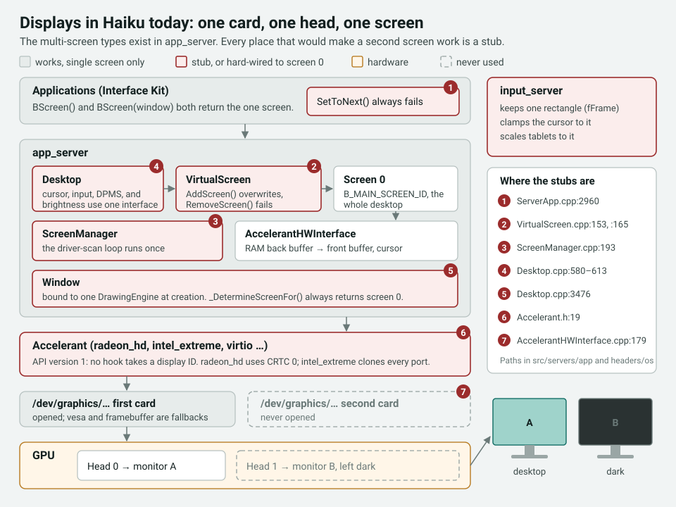
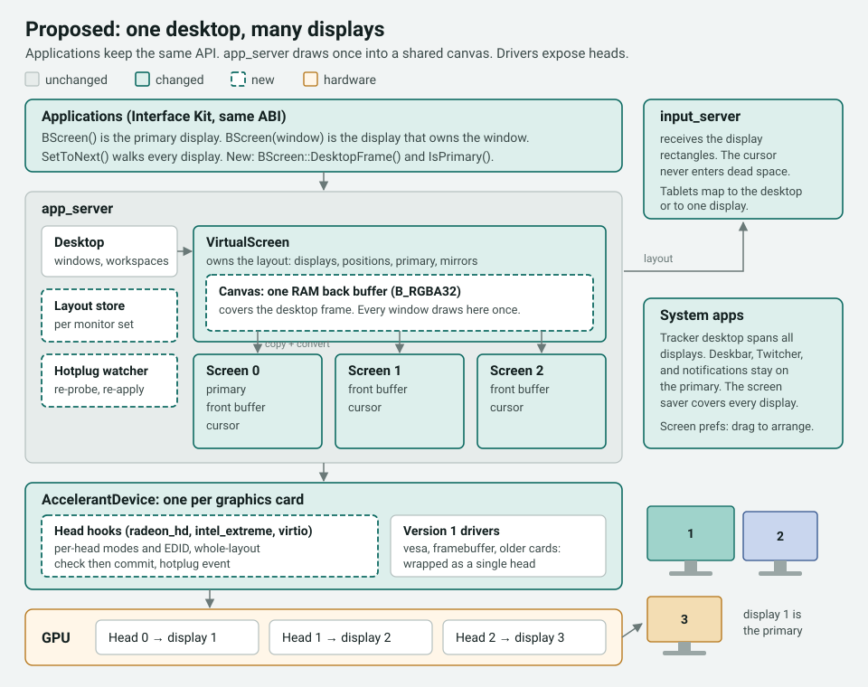
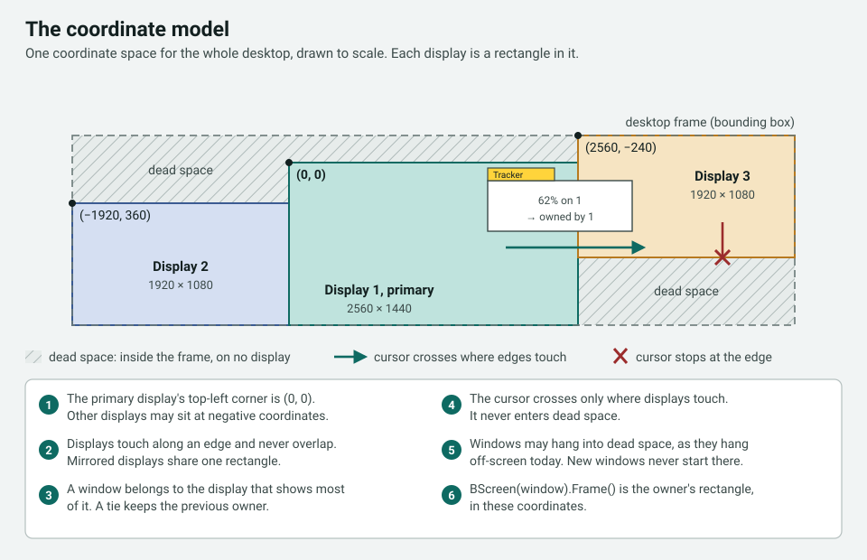
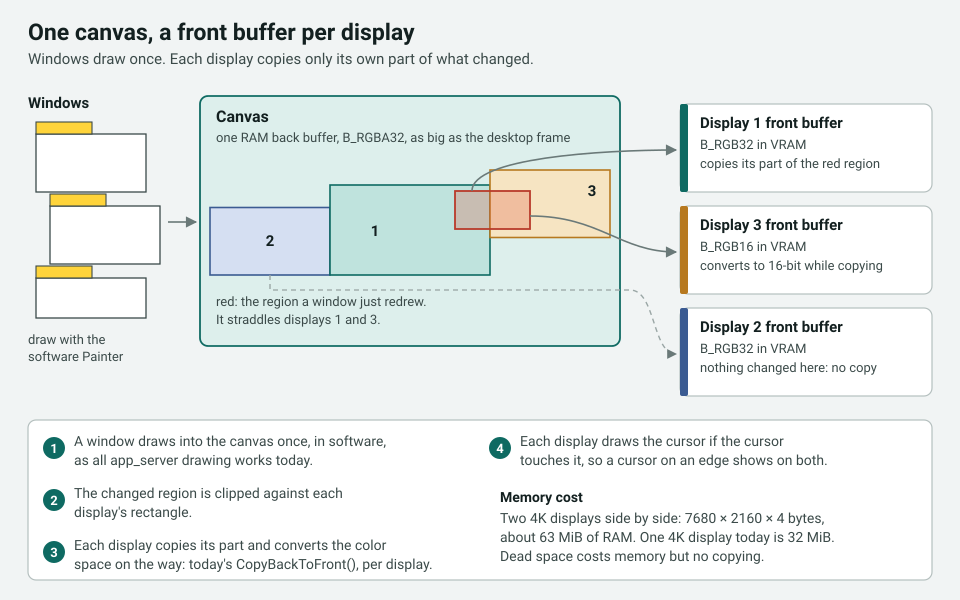
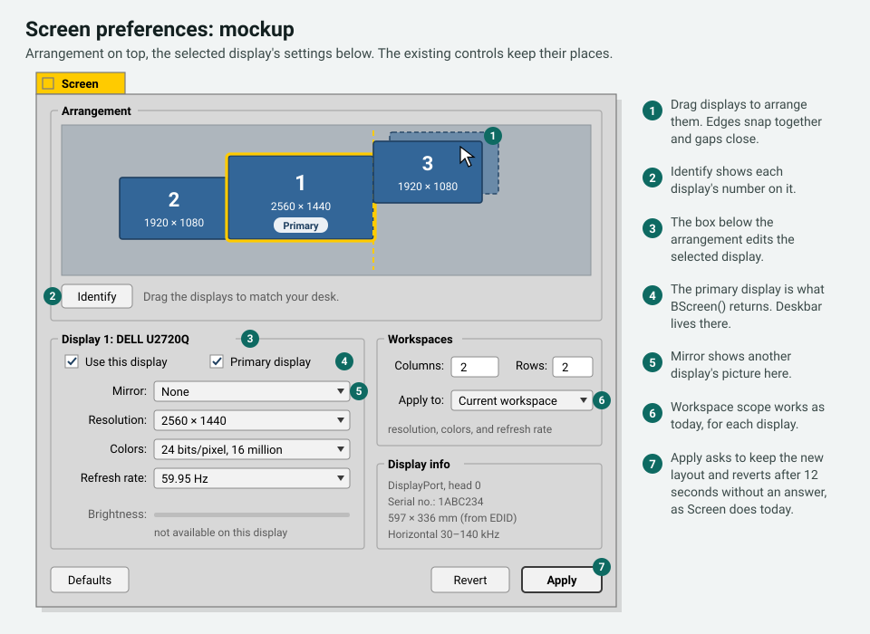
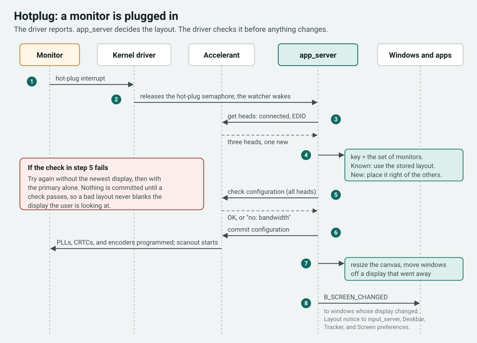
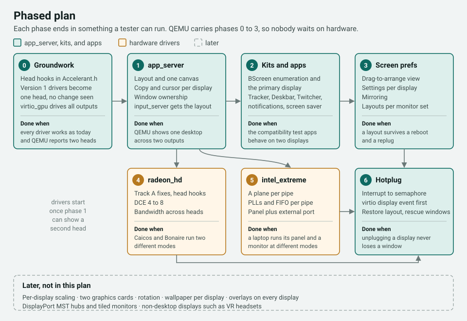

# Multi-monitor support: design proposal

Status: **draft for team review**, 2026-10-30. Owner: Kevin Adams.
Discussion happens in the Desktop on Fire forum thread for this proposal.

Code references are against RenkuOS `main` at `a12ec47176`. Paths without a directory are in
`src/servers/app/`.

---

## Summary

RenkuOS lights one monitor per computer today. This proposal makes every connected display part
of one desktop, and each display gets its own resolution, refresh rate, and color depth. Windows
can sit on any display or straddle two. Applications built for Haiku keep working without a
rebuild, and new applications can ask which display they are on.

The work touches the accelerant API, app_server, input_server, the Interface Kit, Screen
preferences, and three drivers: `virtio_gpu` (QEMU), `radeon_hd`, and `intel_extreme`. It is
split into seven phases. QEMU carries the first four, so anyone on the team can build and test
them without special hardware.

These decisions are already made. They are open to challenge in the thread, and if the thread
agrees they become an entry in [DECISIONS.md](DECISIONS.md).

- Haiku application compatibility does not break. Drivers may change.
- There is no plan to upstream this work or to follow upstream's proposal for it (Gerrit 329).
- A window may straddle two displays. The display that shows most of the window owns it.
- A workspace spans every display. Switching workspaces switches all of them.
- Per-display scaling (HiDPI) is out of scope, but the design leaves room for it.
- `B_MAIN_SCREEN_ID` and a plain `BScreen()` mean the primary display.
- The first drivers are `virtio_gpu`, `radeon_hd`, and `intel_extreme`.

---

## 1. Goals and non-goals

**Goals**

1. Independent displays. Each display has its own mode (resolution, refresh rate, and color
   space), its own power state, and its own brightness where the hardware supports it.
2. One desktop across all displays, arranged by the user, with one primary display.
3. Windows move freely between displays and may straddle them.
4. Mirroring: two displays can show the same picture.
5. Hotplug: plugging a display in or out works without restarting app_server, and a known set of
   monitors gets its previous layout back.
6. Existing applications run unchanged, including gcc2 binaries on x86.
7. Everything up to the hardware drivers can be tested in QEMU.

**Not in this proposal.** Each of these can follow later, and the design does not block any of
them.

- Per-display UI scaling. The layout carries a scale field that is always 1 for now.
- Two or more graphics cards at the same time.
- Rotated displays.
- A different wallpaper on each display.
- Separate workspaces per display.
- DisplayPort MST hubs, tiled 5K monitors, and VR headsets.

---

## 2. How displays work today



app_server was designed with several screens in mind. `VirtualScreen` holds a list of screens,
every `Window` remembers its `Screen`, and `B_SCREEN_CHANGED` goes only to the windows on the
screen that changed (`Desktop.cpp:3641-3676`). Every step that would bring a second screen to
life is a stub.

| Area | Today | Where |
|---|---|---|
| Driver loading | One accelerant, for the first graphics card only. The loop that should find more runs once | `ScreenManager.cpp:193-213`, `drawing/interface/local/AccelerantHWInterface.cpp:179-280` |
| Screen list | `AddScreen()` overwrites the one screen instead of adding. `RemoveScreen()` returns `B_ERROR`. The desktop size is the sum of the widths | `VirtualScreen.cpp:153`, `:165-190` |
| Window placement | `_DetermineScreenFor()` always returns screen 0 | `Desktop.cpp:3476` |
| Cursor, input, DPMS, and brightness | All go through one hardware interface | `Desktop.cpp:580-613`, `:972` |
| Enumeration | `AS_GET_NEXT_SCREEN_ID` always answers "not found". `AS_GET_MODE_LIST` ignores the screen ID | `ServerApp.cpp:2960`, `:3117` |
| Accelerant API | Version 1. No hook takes a display ID | `headers/os/add-ons/graphics/Accelerant.h:19` |
| input_server | One rectangle. Mouse motion is clamped to it and tablets are scaled to it | `src/servers/input/InputServer.cpp:219`, `:1678-1732` |
| Drivers | `radeon_hd` drives CRTC 0 only. `intel_extreme` sets the same mode on every connected port. `virtio_gpu` programs scanout 0 only | `src/add-ons/accelerants/radeon_hd/mode.cpp:180`, `src/add-ons/accelerants/intel_extreme/mode.cpp:486`, `src/add-ons/kernel/drivers/graphics/virtio/virtio_gpu.cpp:436` |

Three things in today's code make the job smaller than it looks.

- **Drawing already goes to a canvas in RAM.** app_server draws every window into a back buffer
  in main memory, always in `B_RGBA32`, and `CopyBackToFront()` copies changed areas to the
  front buffer while converting the color space (`drawing/interface/local/AccelerantHWInterface.cpp:638-658`,
  `drawing/HWInterface.cpp:351-390`). All drawing is done in software by `Painter`. Nothing in the
  drawing path uses the accelerant's 2D hooks, so sharing one canvas between displays gives up
  no acceleration.
- **Most code already asks the right question.** `BWindow::CenterOnScreen()` and
  `MoveOnScreen()`, `BAlert`, most of Deskbar, and Tracker's desktop window all use
  `BScreen(this)` or `BScreen(Window())`. Once app_server answers with the window's own display,
  they follow it.
- **Stored settings already know which monitor they belong to.** Each workspace stores a screen
  configuration, matched to monitors by vendor, product, and serial number
  (`ScreenConfigurations.cpp:42-90`). Switching workspaces can already change the resolution
  (`Desktop.cpp:3720`).

---

## 3. What earlier attempts taught us

### 3.1 The Haiku forum discussion

The Haiku forum thread ["How multiple displays should work?"](https://discuss.haiku-os.org/t/how-multiple-displays-should-work/10126)
ran to 161 posts between November 2020 and May 2026.

- Post #10 reports a long-standing developer consensus that a workspace spans all displays, and
  post #128 confirms that switching workspaces already switches every display.
- Whether a window may straddle two displays was argued for the whole six years without a
  decision. Posts #66 and #76 argue for it. Posts #64, #68, and #101 argue against.
- Four architectures were proposed: a multiplexing drawing interface that forwards each drawing
  call to every screen (#17, #19, #21), a `Desktop` object per screen (#15, #41), one app_server
  per monitor (#101, withdrawn in #107), and accelerant changes, either one accelerant instance
  per display or a display ID on every hook (#11, #13).
- Post #115 sums up the outcome: "by trying to have the perfect solution, we have managed to have
  nothing at all for the last 20 years."

This proposal makes the calls the thread left open: straddling is allowed, workspaces span all
displays, and app_server shares one canvas (§5.4).

### 3.2 Gerrit change 329

[Change 329](https://review.haiku-os.org/c/haiku/+/329), "Add a 'display ID' to most accelerant
hooks", was uploaded in July 2018 and last updated in July 2021. It was never merged and has no
implementation. It changes about 18 hook signatures and raises `B_ACCELERANT_VERSION`, so every
accelerant breaks at once. We borrow two ideas from it, a head count and per-head physical size,
and leave the rest. Our hooks are additions next to the old ones (§5.3).

### 3.3 Our Track A experiment on radeon_hd

In July 2026 the [RadeonHD fork](https://github.com/KevinAdams05/RadeonHDunofficial) drove two
heads with the BeOS-era trick: one `display_mode` with a doubled `virtual_width` and `B_SCROLL`,
split into two by the driver. Clone mode worked on Caicos (DCE 5, `1002:6778`) and Bonaire
(DCE 8), and a 3840×1080 span worked on Bonaire. The work is on branch
`radeonhd/multi-monitor/v0.7.0`, with the [analysis](https://github.com/KevinAdams05/RadeonHDunofficial/blob/radeonhd/multi-monitor/v0.7.0/docs/multi-monitor-analysis.md)
and a [hardware log](https://github.com/KevinAdams05/RadeonHDunofficial/blob/radeonhd/multi-monitor/v0.7.0/docs/multi-monitor-track-a.md).

We are not shipping it. To the OS it is still one wide screen, which is what this proposal
replaces. Its hardware lessons shape the design:

- **Heads share resources.** The PLL allocator never released a PLL. With one head that was
  invisible. With two heads the second mode set found no free PLL.
- **Mode checks are per display.** A mode that one monitor's EDID accepts can be out of range for
  the other monitor.
- **Bandwidth is per board and shared by all heads.** The Caicos card runs its memory at
  154.8 MHz at boot and had 866 MB/s for scanout. Two 1080p heads need 1036 MB/s, and the second
  head showed garbage. The same layout ran cleanly on Bonaire.

So a driver cannot answer "is this mode OK?" one head at a time. It has to see the whole layout,
which is why the new API checks the full configuration before applying anything (§5.3).

---

## 4. How other systems do it

We looked at the other systems we keep source trees for: SerenityOS, Linux, the four BSDs,
Syllable, AtheOS, and ReactOS.

**SerenityOS** is the closest match: a small desktop OS with its own display server and working
multi-monitor support.

- A layout is a list of screens, each with a location, a resolution, and an integer scale, plus
  the index of the main screen (`Userland/Services/WindowServer/ScreenLayout.h`).
- A layout is valid only if no screens overlap, every screen can be reached from the main screen
  through shared edges, and the top-left corner is (0, 0). `normalize()` slides screens until they
  touch (`ScreenLayout.ipp:18-200`).
- The cursor only moves onto a real screen. If a move would leave every screen, the cursor stays
  at the edge of the one it is on (`Screen.cpp:409-425`).
- A window belongs to the screen it overlaps most, falling back to the main screen
  (`Screen.cpp:276-293`). Maximizing and tiling use that screen's rectangle.
- The kernel exposes one device per physical output, with EDID, mode setting, and a safe
  fallback mode (`Kernel/Devices/GPU/DisplayConnector.h`).

**Linux** splits the job between the kernel's mode-setting layer (DRM/KMS) and the compositor.

- An atomic commit with the `TEST_ONLY` flag checks a whole multi-head configuration without
  touching the hardware (`include/uapi/drm/drm_mode.h:1296-1304`). Drivers need this because
  heads share clocks and bandwidth, which is the same lesson as Track A.
- A hotplug event names the connector that changed (`drivers/gpu/drm/drm_sysfs.c:444-490`).
  Userspace re-reads the connectors and decides what to do.
- Connectors carry properties that later features will need: `TILE` for monitors driven as two
  halves, `non-desktop` for VR headsets, `link-status` for a DisplayPort link that failed, and
  `panel orientation` (`drivers/gpu/drm/drm_connector.c`).
- `vkms` is a virtual mode-setting driver for testing compositors without hardware.

**Windows** (our ReactOS checkout only has the driver kit headers, so this part comes from
Microsoft's public documentation).

- The primary monitor's top-left corner is (0, 0). Other monitors may have negative coordinates.
- `MonitorFromWindow()`, `MonitorFromPoint()`, and `MonitorFromRect()` take a fallback flag:
  nearest monitor, primary monitor, or none.
- When a monitor goes away, windows on it are moved to a remaining monitor.
- Older programs see the primary monitor through the old calls. Newer programs use the new ones.

**FreeBSD, DragonFly BSD, OpenBSD, and NetBSD** import Linux's DRM drivers, and their consoles
are single-display. **Syllable and AtheOS** have one display driver and one screen mode per
desktop, the same model as BeOS (Syllable's `appserver/server/desktop.cpp:109-272`).

What we take:

| Idea | From | Where it lands |
|---|---|---|
| Layout rules: no overlap, displays touch, one primary | SerenityOS | §5.2 |
| Primary display at (0, 0), negative coordinates allowed | Windows | §5.2 |
| The cursor never enters dead space | SerenityOS | §5.5 |
| A window belongs to the display that shows most of it | SerenityOS, Windows | §5.2 |
| Old calls see the primary display, new calls see everything | Windows | §5.6 |
| Check the whole configuration, then commit it | Linux | §5.3 |
| Hotplug reports a change, and userspace decides the layout | Linux | §5.9 |
| A virtual multi-output device for testing | Linux `vkms`, SerenityOS | §7 |

---

## 5. Proposed design



### 5.1 Terms

- **Display**: a monitor or a built-in panel.
- **Head**: the driver's path to one display, made of a CRTC or pipe, an encoder, and a connector.
- **Screen**: app_server's object for one active display in the layout, and what `BScreen`
  describes. Mirrored displays share one screen.
- **Layout**: the screens, their positions and modes, which one is primary, and which displays
  mirror which.
- **Desktop frame**: the smallest rectangle that contains every screen.
- **Dead space**: the parts of the desktop frame that no display shows.
- **Primary display**: the screen whose top-left corner is (0, 0). It is `B_MAIN_SCREEN_ID`.

### 5.2 Coordinate model



All windows live in one coordinate space, as they do today. Each screen is a rectangle in that
space.

1. **The primary display's top-left corner is (0, 0).** Displays to its left or above it have
   negative coordinates. This keeps old code working: anything that calls `MoveTo(0, 0)` or
   assumes `BScreen().Frame()` starts at the origin lands on the primary display. SerenityOS
   instead moves the whole layout so its top-left corner is (0, 0), which would put the primary
   display somewhere else whenever a display sits to its left.
2. **Displays touch and never overlap.** Every display shares at least part of an edge with
   another one. Mirrored displays share one rectangle. app_server rejects a layout that breaks
   these rules, and Screen preferences snaps displays together so users never produce one.
3. **A window belongs to the display that shows the largest part of it.** A tie keeps the
   previous owner, so a window does not flicker between owners while it is dragged across an
   edge. A window that no display shows at all belongs to the nearest display. The owner decides
   what `BScreen(window)` returns, where `CenterOnScreen()` centers, and later which scale
   applies.
4. **The cursor crosses only where displays touch.** It never enters dead space (§5.5).
5. **Windows may hang into dead space,** as they hang off-screen today. app_server never places a
   new window there, and `MoveOnScreen()` uses the owner display.
6. **When the owner changes, the window gets `B_SCREEN_CHANGED`** with the new display's frame and
   color space. The existing hook `BWindow::ScreenChanged()` receives it. The skeleton for this
   already exists (`Window::SetScreen()` at `Window.cpp:677`).

### 5.3 Accelerant head API

The accelerant API gains optional hooks in a new feature range. `B_ACCELERANT_VERSION` stays 1,
and nothing about existing hooks changes.

- app_server asks for `B_GET_HEAD_COUNT`. A driver that returns a hook is head-aware. A driver
  that returns `NULL` is a version 1 driver, and app_server wraps it as a single head.
- A head-aware driver keeps answering the version 1 hooks, and they act on the primary head,
  which app_server lists first in every configuration. This keeps `BWindowScreen` and other
  programs that clone the accelerant working.
- Heads are named by a stable ID, normally the connector index, never by their place in a list.
- app_server checks a whole layout in one call before it changes anything, then applies the
  layout in a second call. The driver does every cross-head check in the first call: PLL count
  and sharing, encoder routing, line buffer split, and memory bandwidth at the current clocks.
- Each enabled head scans out its own surface, allocated by the driver. Mirrored heads may share
  one. One surface per head avoids pitch limits and wastes no video memory on dead space. The
  shared canvas lives in main memory anyway (§5.4).
- The driver reports hotplug by releasing a semaphore.

A sketch of the header. The names are not final.

```cpp
// headers/os/add-ons/graphics/Accelerant.h (additions)

enum {
	B_GET_HEAD_COUNT = 0x500,		/* optional: presence means head-aware */
	B_GET_HEAD_INFO,
	B_GET_HEAD_MONITOR_INFO,
	B_GET_HEAD_EDID_INFO,
	B_GET_HEAD_MODE_COUNT,
	B_GET_HEAD_MODE_LIST,
	B_GET_HEAD_PREFERRED_MODE,
	B_CHECK_HEAD_CONFIGURATION,
	B_SET_HEAD_CONFIGURATION,
	B_GET_HEAD_CONFIGURATION,
	B_GET_HEAD_FRAME_BUFFER_CONFIG,
	B_SET_HEAD_DPMS_MODE,
	B_GET_HEAD_DPMS_MODE,
	B_SET_HEAD_BRIGHTNESS,
	B_GET_HEAD_BRIGHTNESS,
	B_SET_HEAD_INDEXED_COLORS,
	B_HEAD_RETRACE_SEMAPHORE,
	B_HEAD_HOTPLUG_SEMAPHORE,
	B_MOVE_HEAD_CURSOR,
	B_SET_HEAD_CURSOR_BITMAP,
	B_SHOW_HEAD_CURSOR
};

typedef struct {
	uint32	id;				/* stable for the life of the device */
	uint32	connector;		/* DisplayPort, HDMI, DVI, VGA, internal, virtual */
	bool	connected;
	bool	internal;		/* built-in laptop panel */
	uint16	width_mm;		/* physical size from EDID, 0 if unknown */
	uint16	height_mm;
	uint32	flags;			/* reserved: tiled, non-desktop */
	uint32	reserved[8];
} display_head_info;

typedef struct {
	uint32			head;		/* display_head_info.id */
	bool			enabled;
	display_mode	mode;		/* virtual size equals visible size, no B_SCROLL */
	uint32			mirror_of;	/* another head's id, or B_NO_MIRROR */
	uint32			reserved[8];	/* rotation, scale */
} display_head_config;

typedef uint32 (*get_head_count)(void);
typedef status_t (*get_head_info)(uint32 index, display_head_info* info);
typedef status_t (*check_head_configuration)(const display_head_config* heads,
	uint32 count, uint32* _failedHead);
typedef status_t (*set_head_configuration)(const display_head_config* heads,
	uint32 count);
typedef status_t (*get_head_frame_buffer_config)(uint32 head,
	frame_buffer_config* config);
typedef sem_id (*head_hotplug_semaphore)(void);
```

The kernel side keeps one `/dev/graphics` entry per card. SerenityOS uses one device per
connector, but our heads share a card's clocks and bandwidth, and the check needs to see all of
them together.

**Version 1 drivers.** `vesa`, `framebuffer`, and the older accelerants (`nvidia`, `matrox`,
`radeon`, `via`, `s3`, `ati`, and the rest) stay single-head. Their BeOS-era span modes keep
working as one wide screen, exactly as today.

### 5.4 app_server: one canvas, many screens



- **`AccelerantDevice`** opens a card, loads its accelerant, and owns the hook table and the
  hotplug watcher thread. Version 1 starts one device, for the first card, as today. The data
  structures allow more, which leaves room for two cards later.
- **`Screen`** stands for one enabled head or mirror group. It owns the front buffer, the cursor,
  the power state, the brightness, and the retrace semaphore for that display.
- **`VirtualScreen`** owns the layout and the canvas. The canvas is one back buffer in main memory,
  `B_RGBA32`, as large as the desktop frame. There is one `DrawingEngine`, and it draws into the
  canvas.
- **`Desktop`** keeps its window management. `_DetermineScreenFor()` implements the ownership rule
  from §5.2.

Drawing works the way it does today, once per display:

1. A window draws into the canvas. Because there is only one `DrawingEngine`, binding a window to
   it at creation (`Window.cpp:95`) stops being a problem.
2. The changed region is clipped against each display's rectangle.
3. Each display copies its part to its front buffer and converts the color space on the way. This
   is today's `CopyBackToFront()`, run once per display.
4. Each display draws the cursor if the cursor touches it, so a cursor on an edge shows on both.

**Why a canvas, and not the designs from the forum thread.** Forwarding every drawing call to
every screen needs per-screen clipping in every call, and it buys nothing, because app_server
does not use 2D acceleration. A `Desktop` per screen is a large rewrite that makes a straddling
window a special case. The canvas is the least code. It matches the back buffer app_server
already has, and straddling comes free.

**What it costs.** Memory: two 4K displays side by side need 7680 × 2160 × 4 bytes, about 63 MiB
of RAM, against 32 MiB for one 4K display today. Dead space costs memory but no copying. The
canvas also has one pixel size everywhere, so it cannot do per-display scaling. When scaling
arrives, the canvas splits into one canvas per display, each with its own scale. The layout and
the API stay the same.

**Locking.** A layout change takes the existing screen write lock and redraws everything, the
same as a mode change today (`Desktop::_ScreenChanged()`).

**Full-screen and direct access.**

- `BDirectWindow` gets the front buffer of the window's owner display. The clipping region it
  receives leaves out any part on another display.
- `BWindowScreen` uses the version 1 hooks, so it takes over the primary display. The other
  displays keep showing the desktop.
- Video overlays stay on the primary head in version 1.

All three are listed as open questions (§9).

### 5.5 Input and cursor

- input_server keeps tracking the cursor position, as today. Instead of one rectangle
  (`src/servers/input/InputServer.cpp:219`), app_server sends it the list of display
  rectangles whenever the layout changes.
- **Mouse motion.** If the new position is on a display, the cursor goes there. If the move would
  cross into dead space, the cursor stops at the edge of the display it is on. A move across an
  edge where two displays touch continues onto the other display. Moving between displays of
  different heights therefore works only along the part of the edge they share, as on Windows.
- **Tablets and touchscreens** map to the desktop frame by default, as today. A point that lands
  in dead space moves to the nearest display. Input preferences gains a per-device setting that
  maps an absolute device to one display, which a laptop touchscreen needs.
- **`set_mouse_position()`** takes desktop coordinates. A point in dead space moves to the
  nearest display.

### 5.6 Application compatibility

The rule: an application that runs today keeps running and sees one sensible display. That
display is the primary, or the one its window is on. Only code that asks for more sees more.

| Call | Today | Proposed |
|---|---|---|
| `BScreen()`, `BScreen(B_MAIN_SCREEN_ID)` | The only screen, which is the whole desktop | The primary display |
| `BScreen(window)` | The only screen | The display that owns the window. The primary if the window is not on screen yet |
| `Frame()` | `(0, 0)` to the mode size | That display's rectangle in desktop coordinates. The primary starts at `(0, 0)` |
| `SetToNext()` | Always fails | Moves to the next display. IDs stay stable while a display is connected |
| `GetMode()`, `SetMode()`, `GetModeList()` | The only screen | That display |
| `GetMode(workspace)`, `SetMode(workspace, …)` | Per workspace | Per workspace, for that display (§5.7) |
| `GetMonitorInfo()`, DPMS, brightness | The only screen | That display |
| `GetBitmap()`, `ReadBitmap()` | The whole screen | That display |
| `WaitForRetrace()` | The only screen | That display |
| `DesktopColor()` | Per workspace | Unchanged. One color across all displays |
| `B_SCREEN_CHANGED` | On a mode change | On a mode change of the owner display, and when the owner changes |

**New API, additions only.** `BScreen` has no virtual functions, so new member functions do not
change its layout or break either ABI.

```cpp
class BScreen {
public:
	// ... existing members unchanged ...

	// RenkuOS additions (names not final)
	static	BRect			DesktopFrame();
				// smallest rectangle that contains every display
			bool			IsPrimary();
};

// Sent to every BApplication when a display is added, removed, moved,
// or made primary. Applications that do not handle it ignore it.
enum { B_SCREEN_LAYOUT_CHANGED = '_SLC' };
```

**Fixes inside libbe.** Menus and tooltips choose their position with `BScreen` of their own
window before that window is on screen (`src/kits/interface/Menu.cpp:2818`,
`src/kits/interface/ToolTipManager.cpp:182`). Under the new rules that would clamp a menu opened
on display 2 to the primary display. They change to use the display under the point where they
open. `libbe.so` is shared, so this fix reaches every
existing application without a rebuild. `BAlert` already centers on its parent window when it
has one (`src/kits/interface/Alert.cpp:651-655`).

**Where old applications behave differently.**

1. An application that saves a window position on display 2 and checks it against
   `BScreen().Frame()` at startup moves the window to the primary display. Older Windows programs
   do the same thing. In-tree applications switch to a check against every display.
2. `B_SCREEN_CHANGED` now also arrives when a window moves to another display. An application
   that resizes itself to fit the screen will fit the new display, which is what it wants.
3. Full-screen code that uses `BScreen(this).Frame()` works on any display. Code that uses
   `MoveTo(0, 0)` lands on the primary display.
4. Code that reads `BScreen().Frame()` as "the whole desktop", such as a screenshot tool or a
   screen saver, sees only the primary display. The in-tree ones are updated. `screen_blanker`
   opens its window on `BScreen(B_MAIN_SCREEN_ID)` (`src/bin/screen_blanker/ScreenBlanker.cpp:73`)
   and must cover every display before it locks the screen, or a password lock leaves the other
   displays readable.
5. Code that forces window positions to `x >= 0` pulls a window off a display to the left of the
   primary.

### 5.7 Workspaces, Deskbar, Tracker, and notifications

- **Workspaces.** A workspace spans every display, and switching workspaces switches all of
  them. The Workspaces applet shows the whole desktop frame.
- **Per-workspace modes.** Haiku lets each workspace have its own resolution, and that is public
  API (`BScreen::SetMode(workspace, …)`). It stays, per display. The arrangement and the primary
  display are the same on every workspace. When a workspace switch changes one display's size,
  the displays to its right and below it shift so that edges keep touching. Whether to keep
  per-workspace modes at all with several displays is an open question (§9).
- **Tracker.** The desktop window spans the desktop frame instead of one screen (today app_server
  sizes it from the screen mode at `Window.cpp:147`). Volume icons start on the primary display.
  Icons never land in dead space, and icons on a display that goes away move to the primary.
  The background image is placed on each display with the existing placement modes. Stretching
  one image across displays comes later.
- **Deskbar** stays on the primary display and follows it when the primary changes.
- **Twitcher and notifications** use the primary display in version 1
  (`src/apps/deskbar/Switcher.cpp:755`, `src/servers/notification/NotificationWindow.cpp:350-359`).

### 5.8 Screen preferences



- An **Arrangement** view at the top draws the displays to scale. Dragging a display moves it,
  and edges snap together, so the layout is always valid. Clicking a display selects it.
- **Identify** shows each display's number on that display.
- The box below edits the selected display: whether it is used, whether it is primary, what it
  mirrors, and its resolution, colors, refresh rate, and brightness.
- The **Workspaces** box and its "Apply to: All workspaces / Current workspace" menu stay as they
  are.
- **Apply** sends the whole layout to app_server in one private call, so app_server can check it
  as a unit, and then shows the existing confirmation that reverts after 12 seconds
  (`src/preferences/screen/AlertWindow.cpp:31`).
- The old "Combine displays" and "Swap displays" menus stay, and appear only for version 1
  drivers that answer the old settings tunnel (`src/preferences/screen/multimon.cpp`).

### 5.9 Hotplug and remembered layouts



- The kernel driver handles the hot-plug interrupt and releases the semaphore that the
  accelerant exports. For `virtio_gpu` the source is the device's display event
  (`VIRTIO_GPU_EVENT_DISPLAY`, `src/add-ons/kernel/drivers/graphics/virtio/viogpu.h:351`).
- app_server's watcher thread re-reads the heads, builds a key from the set of connected
  monitors, and looks for a stored layout with that key. The key is the sorted list of vendor,
  product, serial number, and connector. `ScreenConfigurations` already matches single screens
  this way (`ScreenConfigurations.cpp:42-90`). It grows to match whole layouts.
- A monitor set seen for the first time gets a default: the new display goes to the right of the
  rightmost display, aligned at the top, at its preferred mode. A built-in laptop panel stays
  primary unless the user chose otherwise.
- When a display goes away, its windows move to the primary display. They keep their position
  relative to the display's top-left corner and are pulled in until they fit.
- If the driver rejects the layout, app_server tries again without the newest display, then with
  the primary display alone. Nothing is committed until a check passes.
- **Debounce.** Many DisplayPort monitors drop their hot-plug signal when they go into power
  saving. app_server waits briefly and re-reads before it rearranges anything, and it does not
  move windows off a display that disappeared while the displays were powered down. It waits for
  wake-up instead.
- Startup takes the same path as a hotplug, starting from an empty layout.

---

## 6. Driver work

### 6.1 virtio_gpu (phase 0)

The device protocol supports up to 16 outputs, each with its own EDID (`viogpu.h:231`), but the
kernel driver programs only output 0 (`virtio_gpu.cpp:436-440` and `:614`). Both files are in
`src/add-ons/kernel/drivers/graphics/virtio/`.

- Read the number of outputs from the device configuration, and fetch the EDID of each one.
- Create a resource per enabled output, and send `SET_SCANOUT` and `RESOURCE_FLUSH` per output.
- Add the head hooks to the accelerant in `src/add-ons/accelerants/virtio/`.
- Turn the display event into the hotplug semaphore.

This makes QEMU a multi-monitor test machine for everyone. It comes first because phases 1
through 3 depend on it.

### 6.2 radeon_hd (phase 4)

Most of the per-head plumbing exists. `MAX_DISPLAY` is 2
(`src/add-ons/accelerants/radeon_hd/accelerant.h:25`), every `display_crtc_*` function takes a
CRTC ID, and the register maps cover six CRTCs on DCE 4 and later.

- From the Track A branch, bring over the fixes that are not about spanning: releasing PLLs,
  checking modes per display, applying DPMS to every lit head, and blanking heads that are not
  driven.
- Add the head hooks and a surface per head.
- Implement the whole-layout check: PLLs, DIG and UNIPHY routing, the line buffer split, and
  bandwidth. The fork's `bandwidth.cpp`, still on its way into RenkuOS with the RadeonHD pull
  request series, covers DCE 4 and 5 and needs DCE 6 and 8.
- DCE 3 and older need a real PLL allocator before they can drive two heads.
- Test cards: Caicos and Turks (DCE 5), Bonaire (DCE 8), and Cedar (DCE 4).

### 6.3 intel_extreme (phase 5)

The driver has `Port` and `Pipe` classes, but it sets one mode on every connected port
(`src/add-ons/accelerants/intel_extreme/mode.cpp:486-496`) and writes the same stride to pipes A
and B (`:510-532`).

- Give each pipe its own plane surface and stride, and assign ports to pipes.
- Handle PLL and transcoder sharing on PCH generations, and FIFO and watermark setup per pipe.
- Expect this to be the most bring-up work in the plan. A second display was tried on this
  driver before without success (thread post #140). Register facts come from the Intel
  programmer's reference manuals in our reference library, with page citations, per the project
  rules.

---

## 7. Testing

- **QEMU** with the virtio-gpu device and `max_outputs=2` or `3` covers phases 0 to 3 and the
  hotplug logic. Each output appears as its own window or tab on the host.
- **Layout logic** gets unit tests: layout validation, window ownership, cursor crossing, and the
  monitor-set key. These are plain functions that need no display.
- **Compatibility apps.** A small set of test programs runs on two displays before phase 2 is
  done: `CenterOnScreen()` before and after `Show()`, `BAlert` with and without a parent, a menu
  and a tooltip near a display edge, a full-screen window built from `BScreen(this)`, a
  `BDirectWindow` demo, a `BWindowScreen` demo, the screen saver with a password, and a gcc2
  binary built for BeOS R5.
- **Hardware.** Driver phases are tested on real hardware and name the card model and PCI ID, as
  [REVIEW.md](REVIEW.md) requires. They also quote the syslog lines that show each head's mode
  and list every path that did not run as not tested.

---

## 8. Phased plan



| Phase | Delivers | Done when |
|---|---|---|
| 0. Groundwork | Head hooks in `Accelerant.h`. app_server's device and head split, with version 1 drivers wrapped as one head. `virtio_gpu` drives every output | Every driver works exactly as today, and QEMU reports two heads |
| 1. app_server | Layout, canvas, per-display copy and cursor, window ownership, and the layout sent to input_server | QEMU shows one desktop across two outputs |
| 2. Kits and apps | `BScreen` enumeration, the primary display, the libbe fixes, Tracker, Deskbar, Twitcher, notifications, and the screen saver | The compatibility apps behave on two displays |
| 3. Screen preferences | The arrangement view, settings per display, mirroring, and layouts stored per monitor set | A layout survives a reboot and a replug |
| 4. radeon_hd | Head hooks for DCE 4 to 8, and the whole-layout check | Caicos and Bonaire run two different modes |
| 5. intel_extreme | A plane, PLL, and FIFO per pipe | A laptop runs its panel and a monitor at different modes |
| 6. Hotplug | Interrupt to semaphore in each driver, debounce, layout restore, and window rescue | Unplugging a display never loses a window |

Phases 4 and 5 can start as soon as phase 1 can show a second head, and they can run in parallel
with phases 2 and 3. Each phase lands as pull requests under the 1,000-line limit in
[REVIEW.md](REVIEW.md).

---

## 9. Open questions for the team

1. **Origin.** Primary display at (0, 0) with negative coordinates allowed (proposed), or the
   SerenityOS rule that the layout's top-left corner is (0, 0)?
2. **Per-workspace modes.** Keep a resolution per workspace for each display (proposed), or drop
   per-workspace modes once there is more than one display?
3. **New windows.** Should a window that is not on screen yet belong to the primary display
   (proposed), to the display with the cursor, or to the display with the active window?
4. **System UI.** Should Deskbar, Twitcher, or notifications ever follow the display with the
   cursor?
5. **`BWindowScreen`.** Keep the desktop on the other displays (proposed), or blank them?
6. **`BDirectWindow`.** What should the part of a direct window on a display that does not own it
   show?
7. **Overlays.** Keep them on the primary head in version 1 (proposed), or make them per head
   now?
8. **Mirroring.** When two mirrored displays have different native resolutions, scale one of
   them, or pick a mode both support?
9. **Debounce.** How long should app_server wait after a display disappears before it moves
   windows?
10. **Intel targets.** Which Intel generations and which test laptops come first in phase 5?
11. **Tablets.** Map to the desktop frame by default (proposed), or to the primary display?
12. **Old drivers.** Keep the "Combine displays" menu for BeOS-era drivers (proposed), or retire
    it?

---

## 10. References

- Haiku forum: ["How multiple displays should work?"](https://discuss.haiku-os.org/t/how-multiple-displays-should-work/10126),
  thread 10126.
- Haiku Gerrit: [change 329](https://review.haiku-os.org/c/haiku/+/329), "Add a 'display ID' to
  most accelerant hooks".
- RadeonHD fork, branch `radeonhd/multi-monitor/v0.7.0`:
  [analysis](https://github.com/KevinAdams05/RadeonHDunofficial/blob/radeonhd/multi-monitor/v0.7.0/docs/multi-monitor-analysis.md)
  and [Track A hardware log](https://github.com/KevinAdams05/RadeonHDunofficial/blob/radeonhd/multi-monitor/v0.7.0/docs/multi-monitor-track-a.md).
- SerenityOS: `Userland/Services/WindowServer/ScreenLayout.h`, `ScreenLayout.ipp`, `Screen.cpp`,
  and `Kernel/Devices/GPU/DisplayConnector.h`.
- Linux 7.1-rc4: `include/uapi/drm/drm_mode.h`, `drivers/gpu/drm/drm_connector.c`,
  `drivers/gpu/drm/drm_sysfs.c`, and `drivers/gpu/drm/drm_client_modeset.c`.
- Microsoft: the Win32 "Multiple Display Monitors" documentation, and `MonitorFromWindow()`.
